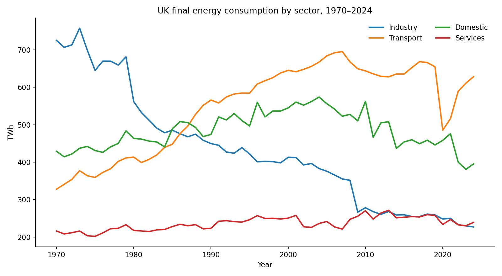
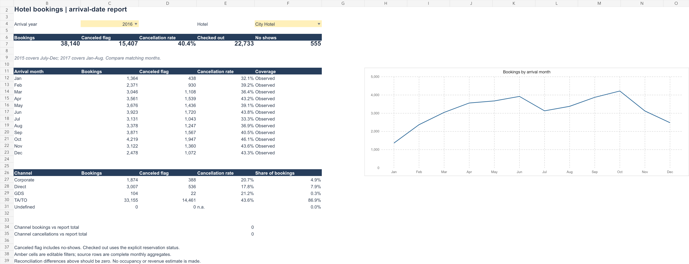
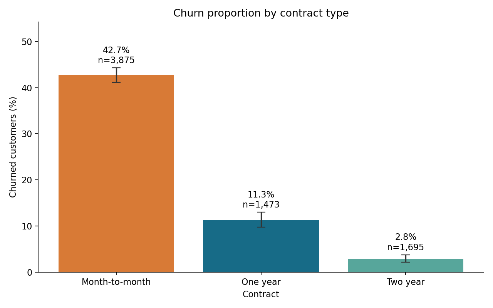
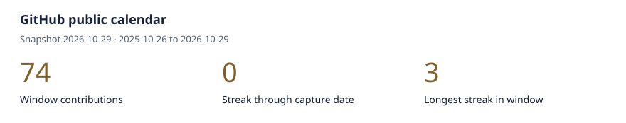
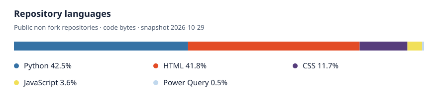
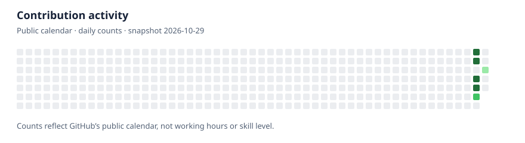

<picture>
  <source media="(prefers-color-scheme: dark)" srcset="assets/profile-cover-dark.svg">
  
</picture>

# Hi, I’m Kelvin

I’m **Kelvin Ojogbede**, an early-career data and technology graduate with a **BSc (Hons) in Information Technology for Business (2:1)** and an **MSc in Data Science & Computational Intelligence** from Coventry University.

I’m targeting graduate and junior roles in **data analytics, BI and insights, business analysis, and technology / application support**. I’m also interested in graduate data science roles where I can build on my machine-learning research.

I use **Python, SQL, Power BI and Excel** to investigate practical questions, check the data and communicate useful findings. My customer-facing experience supports how I listen to problems and explain next steps.

  

**Start with:** [MSc energy research](https://github.com/Kelv-Ojo/uk-energy-analysis) · [SQL & Excel hotel analysis](https://github.com/Kelv-Ojo/hotel-booking-analysis) · [Power BI sales reporting](https://github.com/Kelv-Ojo/Dashboard-sales)

## Featured projects

### [MSc dissertation — UK energy consumption](https://github.com/Kelv-Ojo/uk-energy-analysis)

My MSc dissertation, **Predicting UK Renewable and Non-Renewable Energy Consumption Using Machine Learning**, examined UK data for **1970–2024**, comparing **ARIMA, Random Forest and XGBoost**. The report used MAE, RMSE and MAPE and reported XGBoost as the strongest-performing model. Its original forecasting pipeline has not been reproduced here; numerical forecasts and model scores are withheld pending checks of units, target definitions and time-based evaluation.

[Research summary and verification status](https://github.com/Kelv-Ojo/uk-energy-analysis/blob/main/docs/DISSERTATION-SUMMARY.md). The chart below is the separately reproduced historical analysis, not a forecast.

How has demand changed across sectors? **55 years of official UK data**, with traced source cells, unit checks and reproducible Python/SQL comparisons. Final consumption fell **12.3% between 1970 and 2024**.

   

### [Hotel booking analysis](https://github.com/Kelv-Ojo/hotel-booking-analysis)

Where should hotel teams investigate cancellations? **119,390 historical bookings** reconciled across a relational SQL model and Excel reporting. City Hotel has a **41.7% cancellation-flag rate**, versus **27.8%** for Resort Hotel; the flag includes no-shows.

  

*Static Excel preview: one hotel/year selection. Headline comparisons cover the full snapshot. Earlier Power BI reporting limitations remain documented.*

### [Power BI sales reporting](https://github.com/Kelv-Ojo/Dashboard-sales)

Check what a sales KPI means before using it. The repository preserves an original Power BI report and independently checks **10,018 order lines / 5,026 orders**. Workbook total sales grew **20.3% from 2023 to 2024**.

 

*Python source-data chart, not a Power BI screenshot. Currency and upstream provenance remain unverified; Desktop checks found comparison-card and explanatory-text issues; the full dashboard release is on hold.*

### [Customer churn segmentation](https://github.com/Kelv-Ojo/telco-churn-analysis)

Which groups merit retention research? Compare **7,043 IBM Telco sample customers** using SQL, pandas and descriptive uncertainty intervals. Month-to-month customers show **42.7% churn**, versus **2.8%** for two-year contracts. This is an association, not proof that longer contracts prevent churn.

  

### [Enquiry desk: chatbot to CRM](https://github.com/Kelv-Ojo/Chat_bot)

An **in-development** Python, Streamlit and SQLite prototype: capture an enquiry, suggest a reply, route uncertain cases for human review and report on the queue. Core tests check duplicate handling and reporting consistency.

  

The default demo uses exact intent matches. The optional earlier neural model and live HubSpot round trip remain unverified; the HubSpot adapter is mock-tested only. No commercial deployment or efficiency gain is claimed.

## Technology stack

These tools are grounded in the linked code, reporting artefacts or documented research. [View the evidence](TECHNOLOGY-EVIDENCE.md).

### Programming & data

 &nbsp;  &nbsp; 

  

### Analytics & visualisation

 &nbsp;  &nbsp;  &nbsp;  &nbsp;  &nbsp; 

     

### Machine learning & statistical methods

 &nbsp; 

   

XGBoost and ARIMA are documented dissertation methods; the original forecasting pipeline has not been reproduced in this portfolio review.

### Development tools

 &nbsp;  &nbsp;  &nbsp; 

   

  

HTML, CSS and JavaScript support my portfolio’s filters, case-study dialogs and responsive pages, developed with disclosed AI assistance.

### Databases

 &nbsp;  &nbsp; 

  

SQLite is used in the public analyses and enquiry prototype. SQL Server reflects local exercise experience; the evidence record keeps that scope explicit.

## GitHub activity

The live panel below is served by GitHub Readme Streak Stats. Its **total is account-lifetime**, whereas the dated calendar panels below use GitHub’s displayed contribution window.

<picture>
  <source media="(prefers-color-scheme: dark)" srcset="https://streak-stats.demolab.com?user=Kelv-Ojo&amp;theme=github-dark-blue&amp;hide_border=true">
  
</picture>

If the live service is unavailable, use the [native GitHub activity page](https://github.com/Kelv-Ojo?tab=overview) and the dated fallback panels below.

<picture>
  <source media="(prefers-color-scheme: dark)" srcset="assets/activity-summary-dark.svg">
  
</picture>

<picture>
  <source media="(prefers-color-scheme: dark)" srcset="assets/languages-dark.svg">
  
</picture>

<picture>
  <source media="(prefers-color-scheme: dark)" srcset="assets/contribution-graph-dark.svg">
  
</picture>

Fallback panels are snapshots, **not live widgets**. [Public source data](assets/public-stats.json) · [Refresh and scope notes](STATS.md).

## Verified achievement

**Pull Shark** — visible on my GitHub profile when checked on 29 October 2026. [View GitHub achievements](https://github.com/Kelv-Ojo?tab=achievements).

## How I work

- Define the question, population, metric and reporting period.
- Check missing values, joins, units and reconciliation before interpreting results.
- Keep source evidence and reproducible commands beside the findings.
- Explain limitations and distinguish proposed actions from implemented outcomes.

Further work in my [portfolio](https://kelv-ojo.github.io/) includes a reproducible classification benchmark and data-quality analysis. These are academic and independent projects developed with disclosed AI assistance, not client engagements. Each case study identifies what was verified and what still needs checking.

## Let’s connect

[Portfolio](https://kelv-ojo.github.io/) · [LinkedIn](https://www.linkedin.com/in/kelvin-o-436359174/) · [GitHub](https://github.com/Kelv-Ojo) · [Email](mailto:kelvin08801@gmail.com)
